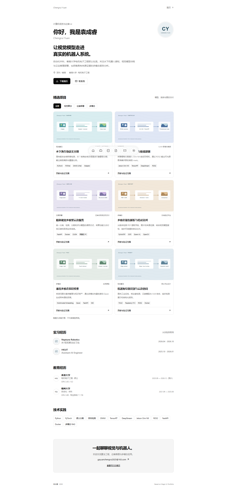

# Chengrui Yuan · Personal portfolio

基于 [Magic UI Portfolio](https://github.com/magicuidesign/portfolio) 的个人网站，展示袁成睿的计算机视觉、Edge AI 与多模态应用经历。

A personal portfolio for Chengrui Yuan, built with Next.js, React, Tailwind CSS and Magic UI. Includes project cases, experience, education, technical articles, dark mode and a printable resume. It exports to static files and can be deployed to GitHub Pages.



## 本地运行

建议使用 Node.js 24（`.nvmrc`），项目要求 Node.js 22 或以上。

```bash
npm ci
npm run dev
```

开发地址通常为 http://localhost:3000 。生产预览：

```bash
npm run build
npm run preview
```

`out/` 是纯静态网站，可放在支持 HTML/CSS/JS 的托管服务。预览脚本自动读取构建时的路径配置。

## 上传 GitHub 并启用外部访问

1. 在自己的 GitHub 账号下创建公开仓库，建议命名 `chengrui-portfolio`；也可以使用 `YOUR_USERNAME.github.io`。
2. 解压源码包，在含有 package.json 的这一层目录打开终端。
3. 将下列示例地址中的 `YOUR_USERNAME` 和仓库名替换为自己的，再执行：

```bash
git init
git add .
git commit -m "Publish personal portfolio"
git branch -M main
git remote add origin https://github.com/YOUR_USERNAME/chengrui-portfolio.git
git push -u origin main
```

4. 在仓库 **Settings → Pages → Build and deployment → Source** 选择 **GitHub Actions**。
5. 若首次推送早于 Pages 设置完成，在 **Actions → Deploy portfolio to GitHub Pages → Run workflow** 手动运行一次。
6. 成功后从 Pages 设置或工作流的 `github-pages` 环境打开网站。项目仓库通常为 `https://YOUR_USERNAME.github.io/chengrui-portfolio/`；账号主页仓库为 `https://YOUR_USERNAME.github.io/`。

GitHub 工作流自动读取实际 `base_path` 和 `base_url`，同时兼容项目路径、账号主页以及已在 Pages 中配置的自定义域名。无需在源码中填写账号，也不需要额外部署密钥。仓库可见性和 Pages 来源需由仓库所有者在 GitHub 设置。

## 修改自己的内容

| 文件/目录                            | 用途                                     |
| ------------------------------------ | ---------------------------------------- |
| `src/data/profile.json`              | 姓名、邮箱、教育、工作、项目、技能和奖项 |
| `src/app/page.tsx`                   | 主页结构与筛选交互                       |
| `src/app/globals.css`                | 页面样式与响应式布局                     |
| `content/*.mdx`                      | 技术文章                                 |
| `public/assets/*.svg`                | 架构示意与字母头像                       |
| `public/resume.pdf`                  | 对外下载的简历 PDF                       |
| `scripts/generate-resume.mjs`        | 根据 profile 生成打印简历页              |
| `.github/workflows/deploy-pages.yml` | 自动构建并发布 GitHub Pages              |

构建前自动生成 `public/resume.html`。修改个人资料后，PDF 可从打印简历页面重新保存，再替换 `public/resume.pdf`；网站不会把旧 PDF 自动当作最新内容。复用本项目时，请将作者姓名、邮箱、工作经历和简历替换成自己的。

默认公开版简历使用姓名、邮箱、教育和项目经历。项目插图是架构示意，指标保留各自的数据集与验证范围。

## 路径与其他托管方式

`.env.example` 提供两项构建配置：

- `NEXT_PUBLIC_BASE_PATH`：根路径时为空，项目路径示例为 `/chengrui-portfolio`。
- `NEXT_PUBLIC_SITE_URL`：完整网站地址，例如 `https://YOUR_USERNAME.github.io/chengrui-portfolio`，不带末尾斜杠。

路径是构建时配置，修改后需重新执行 `npm run build`。GitHub Actions 会自动设置，开发时一般保持为空。使用普通静态托管时直接上传 `out/` 中的内容。

## 检查与开发

```bash
npm test
npm run build
npm run format:check
```

浏览器检查：已有 Chrome/Edge 的电脑可直接执行 `npm run test:e2e`；否则先执行 `npx playwright install chromium`。检查使用本机 127.0.0.1 预览，覆盖手机、桌面、路径、主题、筛选、简历和文章。结果写入已忽略的 `test-results/`。

`docs/VALIDATION.md` 记录本次验证范围。

## 许可与来源

[MIT License](LICENSE)。保留 Dillion Verma / Magic UI Portfolio 的原始版权声明，具体来源见 [NOTICE.md](NOTICE.md)。

部署依据：[GitHub Pages 工作流](https://docs.github.com/en/pages/getting-started-with-github-pages/using-custom-workflows-with-github-pages)、[Next.js 静态导出](https://nextjs.org/docs/app/guides/static-exports)、[Next.js basePath](https://nextjs.org/docs/app/api-reference/config/next-config-js/basePath)。
